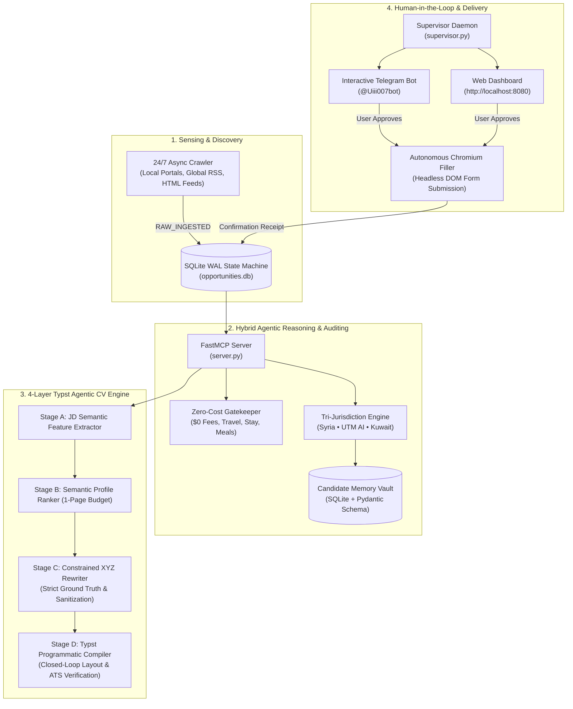

# ZCO-Hunter — Hybrid Agentic Opportunity Engine & Typst CV Synthesizer

## 1. Architectural Philosophy: The Hybrid Architecture

ZCO-Hunter is engineered upon a **Hybrid Architecture** that decouples semantic reasoning from deterministic execution.
Neither plain code nor plain LLM prompts alone suffice for mission-critical autonomous scholarship and opportunity applications:

* **Why Plain Code Fails:** Hardcoded scrapers and heuristic scripts fail when encountering unstructured opportunity descriptions, complex multi-page eligibility criteria, or varied form layouts across global portals.
* **Why Plain Prompts Fail:** LLM zero-shot generation hallucinates credentials, invents numbers, fails at layout compilation (broken LaTeX/Typst braces or character escaping), and cannot maintain persistent state or execute real browser form actions.
* **The Hybrid Solution:**
  1. **Deterministic Execution Layer:** Python 3.11+, SQLite WAL state machine, Selenium/Chromium headless driver, and the Rust-based Typst typesetting engine enforce ground truth, layout boundaries, and form submission.
  2. **Model Context Protocol (FastMCP) Layer:** Exposes deterministic primitives as typed MCP tools (`zco-opportunity-engine`) accessible to any AI agent.
  3. **Agentic Reasoning Layer (Skill):** Performs semantic matching, domain taxonomy classification, JD feature extraction, and XYZ-format tailoring without hallucination.
  4. **Human-in-the-Loop Supervision:** Multi-channel interaction via Telegram Bot (`@Uiii007bot`), Web Dashboard (`http://localhost:8080`), and background supervisor daemon (`supervisor.py`).



---

## 2. Core Candidate Ground Truth & Strict Iron Rules

### Candidate Profile Summary
* **Full Name:** Mohammad Mahdi Alsalkadi
* **Current Status:** 1st-Year Undergraduate, Bachelor of Computer Science (Artificial Intelligence) with Honours
* **Institution:** Universiti Teknologi Malaysia (UTM), Faculty of Computing, Skudai & Kuala Lumpur
* **Academic Standing:** CGPA 3.53 / 4.00
* **Tri-Jurisdiction Status:**
  1. Primary Nationality: Syrian Citizen (`SY`)
  2. Study Jurisdiction: Malaysia International Student Pass (`MY`)
  3. Family Residency: Kuwait Valid Residency / Iqama (`KW`)
* **English Proficiency:** IELTS Academic Band 5.5 (Academic Working)
* **Core Technical Competencies:** Python (AsyncIO, FastAPI), PyTorch (Neural Architectures, Tensor Manipulation), C++, Algorithms & Data Structures, Agentic Orchestration.
* **Field & Outdoor Competencies:** Wilderness Trekking, Tropical Heat Resilience, Capable Swimmer.

### Iron Rules for All Output
1. **Zero Hallucination:** Never fabricate GPA, degrees, awards, or dates. All claims must anchor to `config/candidate_profile.json` or `config/master_profile.yaml`.
2. **Strict Sanitization:**
   * **Matric Number:** Internal university ID only. Strictly excluded from all public and tailored CVs.
   * **Apparel / T-Shirt Sizes (`M`), Passport Numbers, Home Apartment Addresses:** Retained exclusively in the internal Memory Vault for logistics form auto-filling; never exposed on CV documents.
3. **GitHub Privacy Directive:**
   * Candidate's GitHub contains experimental/exploratory repositories.
   * **Never include GitHub URLs on any CV or motivation letter by default**, even for AI or research positions.
   * Only include GitHub if the host organization's application instructions explicitly and mandatorily specify a code repository link (`mandatory github repository required`).
4. **Strict 1-Page Layout Constraint:** Every generated CV must compile to exactly 1 A4 page. If text overflows, the closed-loop verifier automatically triggers concise mode.

---

## 3. FastMCP Tool Catalog (`zco-opportunity-engine`)

The engine exposes 10 typed tools via Model Context Protocol:

| Tool Name | Parameters | Purpose |
|---|---|---|
| `get_crawler_daemon_status` | none | Returns daemon heartbeat, unprocessed queue count, and learned vault fields. |
| `run_six_hour_batch_audit` | `window_hours: float = 6.0` | Audits raw items against $0 cost and Syrian/UTM/Kuwait eligibility rules; auto-applies where possible. |
| `provide_missing_answers_and_resume` | `answers_json: str` | Permanently stores missing answers in SQLite Vault and immediately resumes paused applications. |
| `render_categorized_dashboard` | `location_scope: str, track_filter: str` | Generates verified opportunities matrix in Markdown. |
| `prepare_application_kit` | `opportunity_code: str` | Previews submission package, SOP, receipt, and eligibility audit breakdown. |
| `synthesize_tailored_cv` | `opportunity_code: str, force: bool = false` | Generates vacancy-tailored 1-page ATS Typst CV adapted to the opportunity's domain. |
| `preflight_application_url` | `opportunity_code: str` | Opens the saved apply URL read-only and verifies it is a real fillable form before any browser or submission. |
| `synthesize_base_reference_cv` | `force: bool = false` | Generates the gold-standard Master Reference 1-page Typst CV. |
| `approve_and_submit_opportunity` | `opportunity_code: str` | Evaluates CV requirement, synthesizes tailored CV if required, submits application, and records receipt. |
| `inspect_vault_profile` | none | Returns all stored candidate fields and learning progress. |

---

## 4. Execution Workflows

### Workflow A: Autonomous Batch Auditing & Auto-Apply
1. Agent invokes `run_six_hour_batch_audit(window_hours=6.0)`.
2. Opportunities passing Zero-Cost and Tri-Jurisdiction filters transition to `VERIFIED_ELIGIBLE`.
3. If 100% of required form fields exist in `CandidateMemoryVault`, the engine runs a read-only URL/form preflight. A homepage redirect, news article, login wall, or zero-field page becomes `APPLICATION_FAILED` before Chromium opens.
4. With `allow_submit=True`, the Chromium filler fills required fields, refuses to submit while required inputs are empty, and clicks Submit. Only a real confirmation reference produces `APPLIED_AUTOMATICALLY`; a click without one becomes `SUBMITTED_UNCONFIRMED`. Without `allow_submit`, the result is `READY_FOR_REVIEW`.
5. If novel fields are encountered, status transitions to `PAUSED_NEEDS_USER_INPUT`, prompting the candidate for those specific fields only.

### Workflow B: Interactive Approval & CV Synthesis (Telegram & Web)
1. Candidate views opportunity card on Telegram [@Uiii007bot](https://t.me/Uiii007bot) or Web Dashboard (`http://localhost:8080`).
2. Candidate clicks **"✅ موافقة وتقديم (Approve & Apply)"**.
3. System runs the preflight. If the URL is not a fillable form, it stops and returns the reason without opening Chromium.
4. System checks `is_cv_required_for_opportunity(opp)`:
   - If required: Synthesizes a profile-grounded 1-page Typst CV, attaches it to the application vault, then attempts submission.
   - If not required: Attempts submission through the form filler.
5. Returns the honest status, a real confirmation reference if one was observed, timestamp, and generated documents.

### Workflow C: Self-Learning Vault Updates
1. When candidate supplies missing answers:
   ```bash
   python3 server.py --learn-answers '{"passport_expiry": "2029-01-01"}'
   ```
2. The engine persists these values into SQLite `candidate_vault` and resumes all paused applications without asking again.

---

## 5. Verification & Audit Protocol for External Reviewers

External agents and automated auditors can verify repository integrity using:

```bash
# 1. Run full test suite (17 unit & integration tests)
pytest tests/ -v

# 2. Verify Typst compilation and strict 1-page constraint
python3 server.py --base-cv

# 3. Verify vacancy-tailored CV synthesis
python3 server.py --synthesize-cv INT-AI-044

# 4. Inspect daemon and memory vault state
python3 server.py --status
```
