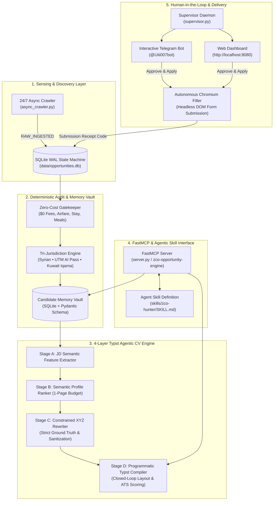

# ZCO-Hunter: Autonomous Zero-Cost Opportunity Engine & Typst Agentic CV Synthesizer

[](https://github.com/mahdialsalkadi/zco-opportunity-engine/actions/workflows/ci.yml)
[](https://www.python.org/downloads/)
[](https://typst.app/)
[](https://modelcontextprotocol.io/)
[](https://www.sqlite.org/)
[](tests/)
[](LICENSE)

An enterprise-grade, autonomous opportunity auditing, memory-learning, and programmatic application system engineered specifically for **Mohammad Mahdi Alsalkadi** (Syrian national, 1st-year Artificial Intelligence undergraduate at Universiti Teknologi Malaysia with honours, CGPA 3.53, Kuwait residency).

---

## 1. Architectural Philosophy: The Hybrid Architecture

ZCO-Hunter rejects the false dichotomy between pure traditional software engineering and zero-shot LLM scripting. Mission-critical autonomous scholarship and research fellowship applications cannot rely on either alone:

* **Why Plain Code Fails:** Static web scrapers break when facing unstructured natural language descriptions, complex eligibility terms, and diverse multi-step application forms.
* **Why Plain Prompts Fail:** Large Language Models hallucinate credentials, invent metrics, corrupt typesetting syntax (broken LaTeX/Typst delimiters), and lack persistent state machines or real browser execution.
* **The Hybrid Solution:**
  1. **Deterministic Core:** Python 3.11+, SQLite WAL concurrency, headless Selenium/Chromium automation, and the Rust-based Typst typesetting engine enforce ground truth, layout boundaries, and verifiable form execution.
  2. **Model Context Protocol (FastMCP):** Standardizes all core functions into 9 typed MCP tools under `zco-opportunity-engine`, enabling any external LLM agent to inspect, audit, and submit without raw bash side-effects.
  3. **Agentic Skill Layer (`zco-hunter`):** Provides high-level semantic reasoning, domain feature extraction, and XYZ-format tailoring without hallucinating profile facts.
  4. **Human-in-the-Loop Supervision:** Real-time multi-channel verification via Telegram Bot ([@Uiii007bot](https://t.me/Uiii007bot)) and Web Dashboard (`http://localhost:8080`), managed 24/7 by a fault-tolerant process supervisor (`supervisor.py`).



---

## 2. The 4-Layer Typst Agentic CV Engine

The CV engine separates raw candidate data from visual presentation, generating ATS-compliant, single-page PDFs dynamically tailored to each opportunity:

1. **Layer 1: Single Source of Truth (`config/master_profile.yaml`):** Contains validated academic history, coursework, algorithmic projects, and field competencies.
2. **Layer 2: Multi-Stage Agentic Pipeline:**
   * **JD Parser & Feature Extractor:** Classifies vacancies across 4 distinct domains (`RESEARCH_LAB`, `AI_POLICY`, `COMMUNITY_VOLUNTEERING`, `ECO_CONSERVATION`).
   * **Semantic Ranker:** Selects the top 2 most relevant projects within a strict 1-page budget.
   * **Constrained XYZ Rewriter:** Rewrites bullet points using Google's XYZ formula (*Accomplished [X] measured by [Y] by doing [Z]*), anchoring exclusively to candidate ground truth.
3. **Layer 3: Programmatic Typst Typesetting (`templates/cv_template.typ`):** Compiles directly via the Rust-based Typst binary in milliseconds, avoiding LaTeX parsing issues and DOM rendering quirks.
4. **Layer 4: Closed-Loop Verification (`ClosedLoopVerifier`):** Programmatically inspects the compiled PDF using `pypdf`. If the document exceeds 1 page, it automatically triggers a concise-mode pass to enforce an exact 1-page boundary.

### Strict Privacy & Sanitization Directives
* **Matric Number:** Omitted from all CV outputs.
* **Apparel Sizes & Private Data:** T-shirt sizes (`M`), passport numbers, and apartment addresses remain internal to the Memory Vault for form auto-filling; never exposed on public CVs.
* **GitHub Policy:** Omitted from all CVs and motivation letters by default. Only included if the host organization explicitly and mandatorily demands a code repository link (`mandatory github repository required`).

---

## 3. Model Context Protocol (FastMCP) Tool Catalog

The server (`server.py`) exposes 9 typed tools for external AI agents:

| Tool Name | Parameters | Description |
|---|---|---|
| `get_crawler_daemon_status` | none | Returns daemon heartbeat, queue status, and Memory Vault fields. |
| `run_six_hour_batch_audit` | `window_hours: float = 6.0, allow_submit: bool = false` | Audits raw items against $0 cost and Syrian/UTM/Kuwait eligibility, then prepares drafts. Submit clicks require explicit opt-in. |
| `provide_missing_answers_and_resume` | `answers_json: str, allow_submit: bool = false` | Persists novel answers into SQLite Vault and resumes paused applications; submission stays opt-in. |
| `render_categorized_dashboard` | `location_scope: str, track_filter: str` | Generates verified opportunities matrix in Markdown. |
| `prepare_application_kit` | `opportunity_code: str` | Returns submission package, SOP, receipt, and audit breakdown. |
| `synthesize_tailored_cv` | `opportunity_code: str, force: bool = false` | Generates vacancy-tailored 1-page ATS Typst CV. |
| `synthesize_base_reference_cv` | `force: bool = false` | Generates the gold-standard Master Reference 1-page Typst CV. |
| `approve_and_submit_opportunity` | `opportunity_code: str` | Human approval action: evaluates CV requirement, synthesizes CV if needed, and submits. Only a real confirmation reference is reported as applied. |
| `inspect_vault_profile` | none | Returns all candidate fields stored in the Memory Vault. |

---

## 4. Verification & Audit Protocol for External Reviewers

External agents and automated audit systems can independently verify this codebase:

```bash
# 1. Clone the repository
git clone https://github.com/mahdialsalkadi/zco-opportunity-engine.git
cd zco-opportunity-engine

# 2. Set up virtual environment & dependencies
python3 -m venv .venv
source .venv/bin/activate
pip install -r requirements.txt

# 3. Configure environment
cp .env.example .env
# - Set TELEGRAM_BOT_TOKEN and TELEGRAM_ADMIN_CHAT_IDS to enable the private bot.
#   The bot refuses to start without at least one admin chat ID.
# - Leave DASHBOARD_AUTH_TOKEN blank to auto-generate data/dashboard_token.txt
#   (chmod 600), or set it explicitly for remote access.
# - Keep ZCO_AUTO_SUBMIT=0 unless you explicitly want unattended Submit clicks.

# 4. Run the full automated test suite (43 unit & integration tests)
pytest tests/ -v

# 5. Verify Master Reference Typst CV synthesis (Strictly 1 Page, 0 Matric, 0 GitHub)
python3 server.py --base-cv

# 6. Verify Vacancy-Tailored Typst CV synthesis (e.g. Caltech SURF)
python3 server.py --synthesize-cv INT-AI-044

# 7. Check Memory Vault Profile state
python3 server.py --profile

# 8. Inspect Process Supervisor & active services
python3 supervisor.py --status

# 9. Optional: foreground health monitor with restart backoff and log rotation
python3 supervisor.py --monitor --interval-seconds 30
```

---

## 5. Safety & Privacy Defaults (Phase 0 Hardening)

* **Private by default:** the web dashboard requires an HttpOnly session cookie (obtained via `/?token=...`) or the `X-Dashboard-Token` header. Wildcard CORS is removed, mutation requests are same-origin checked, and the only unauthenticated routes are `/healthz` and `/favicon.ico`.
* **No unattended submission by default:** batch audits prepare applications and mark them `READY_FOR_REVIEW`. Clicking Submit requires an explicit human approval action or the `ZCO_AUTO_SUBMIT=1` opt-in. The CLI flag is `--auto-submit`.
* **Honest application states:** only a real confirmation reference produces `APPLIED_AUTOMATICALLY`. A clicked-but-unconfirmed submit becomes `SUBMITTED_UNCONFIRMED`; drafts become `READY_FOR_REVIEW`; failures become `APPLICATION_FAILED`. Legacy synthetic `SUB-...` / `DOM-SUB-...` receipts can be downgraded with `python scripts/quarantine_unverified_submissions.py --apply`.
* **Telegram admin allow-list:** every command and callback is denied unless the chat ID is listed in `TELEGRAM_ADMIN_CHAT_IDS`. Scraped text is HTML-escaped before rendering, and bot tokens are redacted from logs.
* **Private files stay private:** `config/candidate_profile.json`, `config/master_profile.yaml`, `config/comprehensive_portfolio.json`, generated CVs, screenshots, dashboards, and the SQLite database are ignored by git. Demo/testbed seeds are opt-in via `async_crawler.py --seed-demo`.

### Reliability Hardening (Phase 1)

* **Versioned SQLite migrations:** `schema_migrations` and additive `ALTER TABLE` migrations upgrade existing databases without deleting rows. Legacy receipt/deadline backfills are explicit migration versions.
* **Source provenance & confidence:** every opportunity stores `source_type`, `source_confidence`, `deadline_confidence`, and `provenance_json`. Local testbeds score near zero, legacy invented deadlines score zero, and the dashboard/Telegram cards show the confidence so a human can verify before applying.
* **Duplicate-submission guard:** already applied or unconfirmed opportunities are not submitted again unless `force_resubmit=true` is passed deliberately.
* **Supervisor hardening:** `supervisor.py --monitor` restarts dead services with capped exponential backoff, tracks restart counts, and rotates logs (`ZCO_LOG_MAX_BYTES`, `ZCO_LOG_BACKUPS`, `ZCO_MAX_RESTARTS`).
* **CI hardening:** the workflow has read-only permissions, concurrency cancellation, a timeout, `compileall`, `pip check`, and a private-data/secret scan over tracked files.

---

## 6. ZCO-Hunter v4.2 Field-Ready Enhancements

* **Two-Hop Link Resolver (`async_crawler.py`):** Automatically traverses intermediary opportunity aggregators (OpportunityDesk, YouthOp, OpportunitiesCorners) to extract rich eligibility and funding perks from the article body, detecting the official external application URL (Google Forms, Airtable, university portal) under *"Apply Now"* / *"Official Link"*.
* **SPA Form Adapter (`engines_and_auditor.py`):** Native DOM/ARIA traversal for modern Single Page Application forms (Google Forms, Airtable, Typeform, Microsoft Forms). Inspects `[role="listitem"]`, maps container headings `[role="heading"]` directly to candidate vault keys, and interacts with ARIA inputs (`role="radio"`, `role="checkbox"`, `[jsname]`).
* **Reply-to-Learn Interaction (`telegram_bot.py`):** When an application pauses for a first-time field (`PAUSED_NEEDS_USER_INPUT`), the bot sends an interactive prompt to Telegram ([@Uiii007bot](https://t.me/Uiii007bot)). Replying directly to that message permanently commits the answer to `CandidateMemoryVault` and re-prepares the application. It does **not** auto-submit; the admin must press the explicit approve button.
* **LLM Essay Synthesizer & Persistent QA Bank (`engines_and_auditor.py`):** Produces authentic 250–300 word Statements of Purpose tailored to host organizations, anchoring strictly to candidate's verified background and coursework, cached in the SQLite `learned_qa_bank` table for semantic reuse.

---

## 7. Repository Directory Layout

```
├── .agents/
│   └── skills/zco-hunter/SKILL.md    # Agent Skill definition & orchestrator rules
├── config/
│   ├── candidate_profile.example.json# Sanitized template
│   ├── master_profile.example.yaml   # Sanitized template
│   └── telegram_config.json          # Bot metadata
├── data/                             # Ignored in git (runtime dynamic state)
│   ├── documents/                    # Compiled PDFs
│   ├── logs/                         # Service execution logs
│   └── opportunities.db              # SQLite WAL database
├── scripts/
│   ├── check_no_private_data.py              # CI guard against tracked PII/secrets
│   └── quarantine_unverified_submissions.py  # Dry-run/apply receipt quarantine
├── templates/
│   └── cv_template.typ               # Parametric Typst CV template
├── tests/
│   ├── test_phase1_reliability.py    # Migrations, provenance, confidence, private-data check
│   ├── test_security_phase0.py       # Auth, escaping, receipt honesty regression tests
│   ├── test_supervisor.py            # Log rotation & restart backoff
│   ├── test_telegram_bot.py          # Bot interactions & card rendering
│   ├── test_typst_cv_engine.py       # Typst synthesis, 1-page enforcement, sanitization
│   ├── test_v42_features.py          # Two-hop resolver, Google Forms ARIA, Reply-to-Learn, QA bank
│   └── test_zco_engine.py            # Gatekeeper & eligibility testbed
├── async_crawler.py                  # 24/7 background opportunity discovery & two-hop resolver
├── database.py                       # Concurrent SQLite state machine
├── engines_and_auditor.py            # Eligibility gates, SPA form adapter, & Chromium filler
├── portfolio_and_docs_engine.py      # SOP synthesis & HTML document fallback
├── server.py                         # FastMCP Server & batch audit CLI
├── supervisor.py                     # Multi-process daemon monitor
├── telegram_bot.py                   # Telegram approval bot with Reply-to-Learn (@Uiii007bot)
├── typst_agentic_cv_engine.py        # 4-layer Typst Agentic CV Engine
├── web_dashboard.py                  # Real-time web portal (FastAPI + Tailwind)
├── .env.example                      # Environment variables template
├── .gitignore                        # Git exclusion rules
├── SECURITY.md                       # Auth, secret-handling, and submission-safety policy
├── requirements.txt                  # Python dependencies
└── README.md                         # Architecture guide & documentation
```

---

## 8. License

This project is licensed under the MIT License — see the [LICENSE](LICENSE) file for details.
