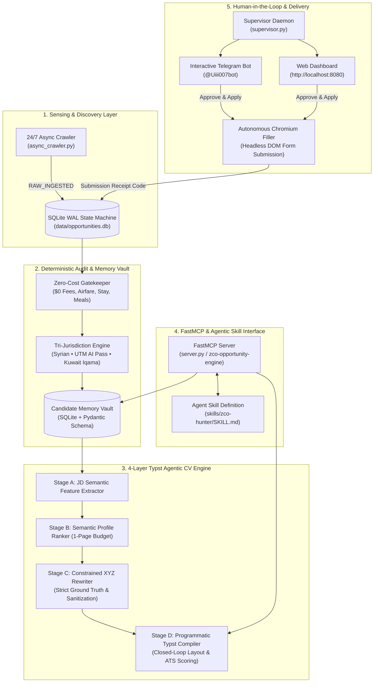

# ZCO-Hunter: Autonomous Zero-Cost Opportunity Engine & Typst Agentic CV Synthesizer

[](https://github.com/mahdialsalkadi/zco-opportunity-engine/actions/workflows/ci.yml)
[](https://www.python.org/downloads/)
[](https://typst.app/)
[](https://modelcontextprotocol.io/)
[](https://www.sqlite.org/)
[](tests/)
[](LICENSE)

An enterprise-grade, autonomous opportunity auditing, memory-learning, and programmatic application system engineered specifically for **Mohammad Mahdi Alsalkadi** (Syrian national, 1st-year Artificial Intelligence undergraduate at Universiti Teknologi Malaysia with honours, CGPA 3.53, Kuwait residency).

---

## 1. Architectural Philosophy: The Hybrid Architecture

ZCO-Hunter rejects the false dichotomy between pure traditional software engineering and zero-shot LLM scripting. Mission-critical autonomous scholarship and research fellowship applications cannot rely on either alone:

* **Why Plain Code Fails:** Static web scrapers break when facing unstructured natural language descriptions, complex eligibility terms, and diverse multi-step application forms.
* **Why Plain Prompts Fail:** Large Language Models hallucinate credentials, invent metrics, corrupt typesetting syntax (broken LaTeX/Typst delimiters), and lack persistent state machines or real browser execution.
* **The Hybrid Solution:**
  1. **Deterministic Core:** Python 3.11+, SQLite WAL concurrency, headless Selenium/Chromium automation, and the Rust-based Typst typesetting engine enforce ground truth, layout boundaries, and verifiable form execution.
  2. **Model Context Protocol (FastMCP):** Standardizes all core functions into 9 typed MCP tools under `zco-opportunity-engine`, enabling any external LLM agent to inspect, audit, and submit without raw bash side-effects.
  3. **Agentic Skill Layer (`zco-hunter`):** Provides high-level semantic reasoning, domain feature extraction, and XYZ-format tailoring without hallucinating profile facts.
  4. **Human-in-the-Loop Supervision:** Real-time multi-channel verification via Telegram Bot ([@Uiii007bot](https://t.me/Uiii007bot)) and Web Dashboard (`http://localhost:8080`), managed 24/7 by a fault-tolerant process supervisor (`supervisor.py`).



---

## 2. The 4-Layer Typst Agentic CV Engine

The CV engine separates raw candidate data from visual presentation, generating ATS-compliant, single-page PDFs dynamically tailored to each opportunity:

1. **Layer 1: Single Source of Truth (`config/master_profile.yaml`):** Contains validated academic history, coursework, algorithmic projects, and field competencies.
2. **Layer 2: Multi-Stage Agentic Pipeline:**
   * **JD Parser & Feature Extractor:** Classifies vacancies across 4 distinct domains (`RESEARCH_LAB`, `AI_POLICY`, `COMMUNITY_VOLUNTEERING`, `ECO_CONSERVATION`).
   * **Semantic Ranker:** Selects the top 2 most relevant projects within a strict 1-page budget.
   * **Constrained XYZ Rewriter:** Rewrites bullet points using Google's XYZ formula (*Accomplished [X] measured by [Y] by doing [Z]*), anchoring exclusively to candidate ground truth.
3. **Layer 3: Programmatic Typst Typesetting (`templates/cv_template.typ`):** Compiles directly via the Rust-based Typst binary in milliseconds, avoiding LaTeX parsing issues and DOM rendering quirks.
4. **Layer 4: Closed-Loop Verification (`ClosedLoopVerifier`):** Programmatically inspects the compiled PDF using `pypdf`. If the document exceeds 1 page, it automatically triggers a concise-mode pass to enforce an exact 1-page boundary.

### Strict Privacy & Sanitization Directives
* **Matric Number (`***REMOVED-MATRIC***`):** Omitted from all CV outputs.
* **Apparel Sizes & Private Data:** T-shirt sizes (`M`), passport numbers, and apartment addresses remain internal to the Memory Vault for form auto-filling; never exposed on public CVs.
* **GitHub Policy:** Omitted from all CVs and motivation letters by default. Only included if the host organization explicitly and mandatorily demands a code repository link (`mandatory github repository required`).

---

## 3. Model Context Protocol (FastMCP) Tool Catalog

The server (`server.py`) exposes 9 typed tools for external AI agents:

| Tool Name | Parameters | Description |
|---|---|---|
| `get_crawler_daemon_status` | none | Returns daemon heartbeat, queue status, and Memory Vault fields. |
| `run_six_hour_batch_audit` | `window_hours: float = 6.0` | Audits raw items against $0 cost and Syrian/UTM/Kuwait eligibility. |
| `provide_missing_answers_and_resume` | `answers_json: str` | Persists novel answers into SQLite Vault and resumes paused applications. |
| `render_categorized_dashboard` | `location_scope: str, track_filter: str` | Generates verified opportunities matrix in Markdown. |
| `prepare_application_kit` | `opportunity_code: str` | Returns submission package, SOP, receipt, and audit breakdown. |
| `synthesize_tailored_cv` | `opportunity_code: str, force: bool = false` | Generates vacancy-tailored 1-page ATS Typst CV. |
| `synthesize_base_reference_cv` | `force: bool = false` | Generates the gold-standard Master Reference 1-page Typst CV. |
| `approve_and_submit_opportunity` | `opportunity_code: str` | Evaluates CV requirement, synthesizes CV if needed, and submits. |
| `inspect_vault_profile` | none | Returns all candidate fields stored in the Memory Vault. |

---

## 4. Verification & Audit Protocol for External Reviewers

External agents and automated audit systems can independently verify this codebase:

```bash
# 1. Clone the repository
git clone https://github.com/mahdialsalkadi/zco-opportunity-engine.git
cd zco-opportunity-engine

# 2. Set up virtual environment & dependencies
python3 -m venv .venv
source .venv/bin/activate
pip install -r requirements.txt

# 3. Configure environment
cp .env.example .env
# Edit .env with your Telegram bot token if running the bot

# 4. Run the full automated test suite (17 unit & integration tests)
pytest tests/ -v

# 5. Verify Master Reference Typst CV synthesis (Strictly 1 Page, 0 Matric, 0 GitHub)
python3 server.py --base-cv

# 6. Verify Vacancy-Tailored Typst CV synthesis (e.g. Caltech SURF)
python3 server.py --synthesize-cv INT-AI-044

# 7. Check Memory Vault Profile state
python3 server.py --profile

# 8. Inspect Process Supervisor & active services
python3 supervisor.py --status
```

---

## 5. Repository Directory Layout

```
├── .agents/
│   └── skills/zco-hunter/SKILL.md    # Agent Skill definition & orchestrator rules
├── config/
│   ├── candidate_profile.json        # Ground truth candidate data
│   ├── master_profile.yaml           # Structured portfolio & coursework
│   └── telegram_config.json          # Bot metadata
├── data/                             # Ignored in git (runtime dynamic state)
│   ├── documents/                    # Compiled PDFs
│   ├── logs/                         # Service execution logs
│   └── opportunities.db              # SQLite WAL database
├── templates/
│   └── cv_template.typ               # Parametric Typst CV template
├── tests/
│   ├── test_telegram_bot.py          # Bot interactions & card rendering
│   ├── test_typst_cv_engine.py       # Typst synthesis, 1-page enforcement, sanitization
│   └── test_zco_engine.py            # Gatekeeper & eligibility testbed
├── async_crawler.py                  # 24/7 background opportunity discovery
├── database.py                       # Concurrent SQLite state machine
├── engines_and_auditor.py            # Eligibility gates & Chromium form auto-filler
├── portfolio_and_docs_engine.py      # SOP synthesis & HTML document fallback
├── server.py                         # FastMCP Server & batch audit CLI
├── supervisor.py                     # Multi-process daemon monitor
├── telegram_bot.py                   # Telegram approval bot (@Uiii007bot)
├── typst_agentic_cv_engine.py        # 4-layer Typst Agentic CV Engine
├── web_dashboard.py                  # Real-time web portal (FastAPI + Tailwind)
├── .env.example                      # Environment variables template
├── .gitignore                        # Git exclusion rules
├── requirements.txt                  # Python dependencies
└── README.md                         # Architecture guide & documentation
```

---

## 6. License

This project is licensed under the MIT License — see the [LICENSE](LICENSE) file for details.
